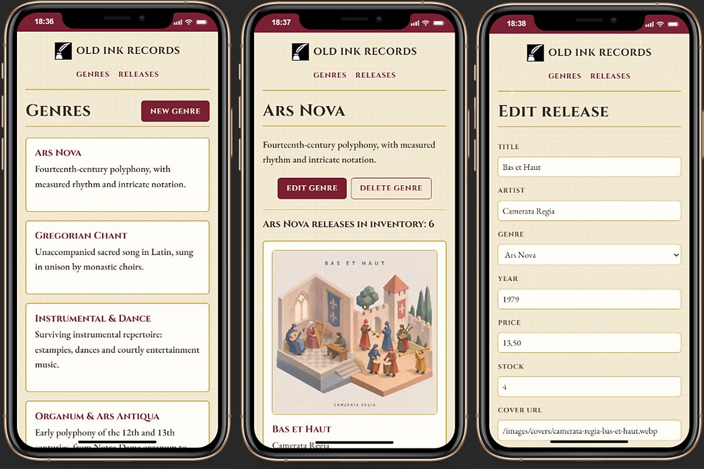

# Inventory Application

<div align="center">

An inventory application built for The Odin Project's NodeJS curriculum, themed as a medieval music record shop.

**Built with:**

    

[View Code](https://github.com/BatetDev/top-project-inventory-application) - [Live Demo](https://top-project-inventory-application-u2oi.onrender.com)

</div>



## 📖 About

An inventory application for a record shop specialising in medieval music. Users can browse releases by genre, and create, edit and delete both releases and genres.

The live demo is deployed on [Render](https://render.com/) and uses [Neon](https://neon.tech/) as its hosted PostgreSQL database, while local development runs against a local PostgreSQL instance.

The application emphasises server-side fundamentals:

- Express routing with separate route and controller files
- A PostgreSQL schema with a foreign key relationship and `ON DELETE RESTRICT`
- Parameterised SQL queries via `pg` and a connection pool
- Server-side validation and constraint-error handling
- EJS templating with server-rendered HTML
- A seed script that rebuilds the schema and populates it with sample data

Built as part of The Odin Project's NodeJS curriculum.

## 🌫️ Key Features

✅ Full CRUD for releases and genres  
✅ Browse all releases, or view them grouped by genre  
✅ Genre pages list every release in that genre  
✅ Genre deletion is blocked while releases still reference it  
✅ Duplicate genre names and invalid foreign keys surface as readable form errors  
✅ Server-side validation independent of browser `required` attributes  
✅ Cover art with a fallback placeholder for releases without one  
✅ Seeded with 5 genres and 35 releases

## 🛠 Built With

- [Node.js](https://nodejs.org/) as the runtime
- [Express](https://expressjs.com/) for routing and middleware
- [PostgreSQL](https://www.postgresql.org/) for persistence
- [Render](https://render.com/) for hosting the live demo
- [Neon](https://neon.tech/) for hosted, serverless PostgreSQL in production
- [pg](https://node-postgres.com/) as the PostgreSQL client
- [EJS](https://ejs.co/) for server-rendered views

## 🧪 Getting Started

Requires Node.js 20.6 or newer and either a local PostgreSQL instance or a free [Neon](https://neon.tech/) project.

```bash
# Clone the repository
git clone https://github.com/BatetDev/top-project-inventory-application.git

# Navigate to project directory
cd top-project-inventory-application

# Install dependencies
npm install

# Configure environment variables
cp .env.example .env
# then edit .env with your database connection details (see below)

# Create the tables and seed sample data
npm run seed

# Run development server (with file watching)
npm run dev
```

### Database setup

**Option A: Local PostgreSQL**

```bash
createdb top_project_inventory_app
```

Then set your local connection details in `.env`.

**Option B: Neon**

1. Create a project at [neon.tech](https://neon.tech/).
2. Copy the connection string from the Neon dashboard.
3. Paste it into `.env` as your database URL (Neon requires SSL, so keep `sslmode=require` in the string).

The app runs at `http://localhost:3000`.

## 📜 Credits

- Original project by: [The Odin Project](https://www.theodinproject.com/lessons/node-path-nodejs-inventory-application)
- Background texture: [Hero Patterns](https://heropatterns.com/)
- Logo: ["Quill and ink"](https://game-icons.net/1x1/lorc/quill-ink.html#download) by [Lorc](https://lorcblog.blogspot.com/), [CC BY 3.0](https://creativecommons.org/licenses/by/3.0/)
- Cover art: AI-generated placeholder images
